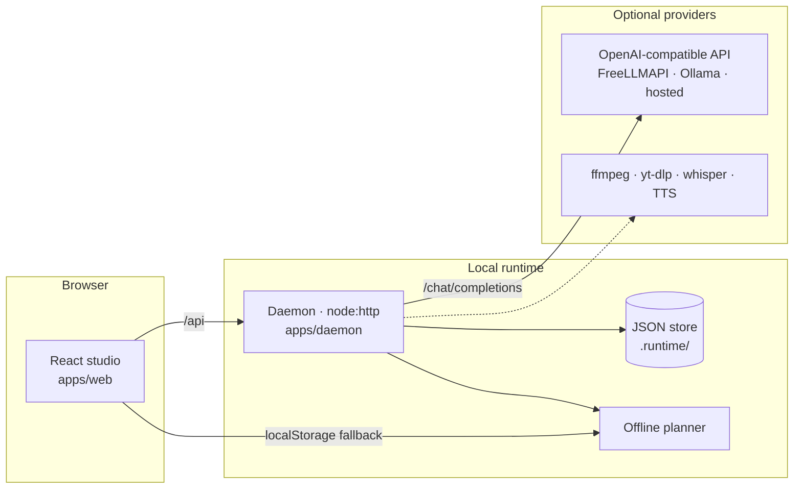

<div align="center">


# Open Creator AI

**An open-source AI workspace for creators — plan, generate and ship video, image and audio content from one agent-native studio.**

[](https://github.com/meheditwc/open-creator-ai/actions/workflows/ci.yml)
[](LICENSE)
[](https://nodejs.org)
[](packages/shared)
[](apps/web)
[](apps/daemon)
[](CONTRIBUTING.md)

</div>

<div align="center">


</div>

---

## Why Open Creator AI?

Most AI media tools are a chat box that throws a file at you. Open Creator AI is a **workspace**: projects on the left, a real pipeline catalogue in the middle, and an agent that knows how your tools chain together.

| Principle                    | What it means                                                                                                        |
| ---------------------------- | -------------------------------------------------------------------------------------------------------------------- |
| **Bring your own model**     | Any OpenAI-compatible endpoint — a free local router, Ollama, LM Studio, LiteLLM, vLLM or a hosted API.              |
| **Bring your own tools**     | `ffmpeg`, `yt-dlp`, `whisper`, a TTS engine — the studio detects what you have and adapts the plan.                  |
| **Everything is yours**      | Apache-2.0 licensed, self-hosted, no telemetry, no account, no cloud lock-in.                                        |
| **Works without a model**    | A built-in offline planner answers with a real pipeline plan, so the studio is useful before you configure anything. |
| **Zero native dependencies** | `npm install` never compiles anything. The daemon is plain Node.js — it starts in milliseconds.                      |
| **Renders real files**       | Runs produce downloadable PNG / MP4 / SRT / MD files in `apps/daemon/.runtime/artifacts/`, served by the daemon.     |
| **Real pictures**            | Images come from your image model, then a keyless service, then procedural art — never a blank gradient.             |

---

## Quick start

```bash
git clone https://github.com/meheditwc/open-creator-ai.git
cd open-creator-ai
npm install
npm run setup:media   # installs a local ffmpeg if you do not have one
npm run dev
```

That starts two processes:

| Service    | URL                    | What it does                                                |
| ---------- | ---------------------- | ----------------------------------------------------------- |
| **Studio** | http://localhost:19861 | The web workspace (React + Vite)                            |
| **Daemon** | http://127.0.0.1:9861  | Local runtime: projects, runs, settings, the agent endpoint |

Open <http://localhost:19861>, pick a tool, type a prompt and press **Start run**. A few
seconds later the run shows its files — click it to preview the image/video or download it.
No account, no key, no setup wizard.

> `npm run setup:media` is only needed when `ffmpeg` is not already on your PATH. The
> script tries `pip3 install imageio-ffmpeg`, then a static build from GitHub, and writes
> the binary to `apps/daemon/.bin/` (git-ignored). Docker users need nothing extra.

<details>
<summary><b>Connect a model provider (optional)</b></summary>

The studio works offline out of the box. To unlock the full agent, point it at any
OpenAI-compatible endpoint — for example a self-hosted [FreeLLMAPI](https://github.com/tashfeenahmed/freellmapi):

```bash
docker run -d -p 3001:3001 ghcr.io/tashfeenahmed/freellmapi:latest
```

Then in **Settings → Model provider**:

- **Base URL** — `http://localhost:3001/v1`
- **API key** — the unified key from `http://localhost:3001`
- **Model** — e.g. `gpt-4o-mini`

</details>

---

## What's inside

```
open-creator-ai/
├── apps/
│   ├── web/          # React 19 + Vite + TypeScript studio
│   └── daemon/       # Node.js runtime — HTTP API, JSON store, agent endpoint
├── packages/
│   └── shared/       # Types, tool catalogue, offline planner, API client
├── skills/           # Codex-style skills for agent workflows
├── docs/             # Architecture, guides, tool reference
└── .github/          # CI, issue forms, PR template
```

| Package           | Stack                                          | Responsibility                                                               |
| ----------------- | ---------------------------------------------- | ---------------------------------------------------------------------------- |
| `apps/web`        | React 19, Vite 8, TypeScript, hand-written CSS | The studio UI — dashboard, tool catalogue, agent, projects, settings         |
| `apps/daemon`     | Node.js 22 (`node:http`, `node:fs`)            | Projects, runs, settings, agent endpoint, static hosting of the built studio |
| `packages/shared` | TypeScript                                     | Domain types, tool catalogue, offline planner, reusable API client           |

> **Why no framework?** The studio's CSS is a single hand-rolled design system
> (`apps/web/src/styles/global.css`) — no Tailwind, no PostCSS, no build-time
> surprises, and no dead weight in the bundle.

---

## Creator tools

Every tool is a documented pipeline with typed inputs, outputs and requirements.

| Tool                       | Category | Status | Renders today                                                            |
| -------------------------- | -------- | ------ | ------------------------------------------------------------------------ |
| **Thumbnail Generator**    | image    | stable | 1–6 typographic PNG thumbnails + prompt log, no provider needed          |
| **Image Generation**       | image    | stable | Cover art PNG (16:9 + 1:1) + prompt log                                  |
| **Video Generation**       | video    | stable | MP4 clip with burned-in kinetic captions + SRT/VTT                       |
| **Short Video Script**     | text     | stable | Segmented script (MD), vertical teaser MP4, SRT                          |
| **Stick Figure Animation** | video    | stable | Stick-figure MP4 animation + storyboard PNGs + narration script          |
| **Subtitle Studio**        | utility  | stable | SRT + VTT + a captioned preview MP4                                      |
| **Article Writer**         | text     | stable | Article as Markdown + a styled self-contained HTML file                  |
| **Workflow Planner**       | utility  | stable | A sequenced, tool-aware plan as Markdown                                 |
| **Video Translation**      | video    | beta   | Timed source SRT + worksheet; translation/dub need a text + TTS provider |
| **Voiceover & Dubbing**    | audio    | beta   | Narration script + timed SRT; the audio track needs a TTS provider       |
| **Video Downloader**       | video    | beta   | Real downloads; needs `yt-dlp` on the machine                            |

**Everything in the `stable` rows runs on your machine with ffmpeg alone — no API key, no
account, no cloud.** Images are generated in three tiers: your own image model when one is
configured, a keyless public image service when it is reachable, and procedural art
otherwise — so a run always produces a picture, and the run notes tell you which tier ran. The `beta` rows produce the parts that do not need a model, and say
exactly what is missing instead of pretending to succeed.

See [`docs/TOOLS.md`](docs/TOOLS.md) for the full reference, and
[`packages/shared/src/tools.ts`](packages/shared/src/tools.ts) for the source of truth.

---

## The studio

<div align="center">

<table>
<tr>
<td width="50%"></td>
<td width="50%"></td>
</tr>
<tr>
<td align="center"><b>Tool catalogue</b> — filter by category, search, inspect every pipeline</td>
<td align="center"><b>Tool detail</b> — inputs, stages, outputs, requirements, one-click run</td>
</tr>
<tr>
<td></td>
<td></td>
</tr>
<tr>
<td align="center"><b>The agent</b> — markdown answers, live suggestions, provider status</td>
<td align="center"><b>Projects</b> — group runs, archive, and track every execution</td>
</tr>
</table>

</div>

<details>
<summary><b>Light theme & mobile</b></summary>

<div align="center">

<table>
<tr>
<td width="50%"></td>
<td width="50%"></td>
</tr>
<tr>
<td align="center"><b>Light theme</b> — follows the toggle in the top bar</td>
<td align="center"><b>Responsive</b> — the sidebar collapses to a chip bar</td>
</tr>
</table>

</div>

</details>

---

## Architecture



- **One contract, two clients.** `packages/shared` holds the types, the tool
  catalogue and a ready-made `CreatorClient` — the UI, a Codex skill, an MCP
  server or a CI job all speak the same API.
- **Degrade, never break.** If the daemon is unreachable the studio keeps
  working from `localStorage` and the agent falls back to the offline planner.
  If the model provider is unreachable, the daemon answers with the same
  planner. If `ffmpeg` is missing, the tool still shows you the plan.
- **Atomic persistence.** Every write goes to a temp file and is renamed into
  place, so a crash can never leave a half-written project file behind.
- **Real renders, honest gaps.** The daemon shells out to ffmpeg and writes actual
  files into `artifacts/<runId>/`; every run records the files it produced. When a
  tool needs something the machine does not have (a provider key, `yt-dlp`), the
  run fails with the exact missing piece instead of a fake "completed".

Read the full design notes in [`docs/ARCHITECTURE.md`](docs/ARCHITECTURE.md).

---

## Configuration

Everything is optional — copy `.env.example` to `.env` when you want to change a default.

| Variable                 | Default                    | Purpose                                        |
| ------------------------ | -------------------------- | ---------------------------------------------- |
| `PORT`                   | `9861`                     | Daemon port                                    |
| `OPENCREATOR_HOST`       | `127.0.0.1`                | Daemon bind address                            |
| `OPENCREATOR_DATA_DIR`   | `.runtime`                 | Where projects, runs and settings are stored   |
| `OPENCREATOR_CORS`       | `*`                        | Allowed browser origins (comma separated)      |
| `FREELLMAPI_BASE_URL`    | `http://localhost:3001/v1` | Default provider base URL                      |
| `FREELLMAPI_API_KEY`     | —                          | Default provider key                           |
| `OPENCREATOR_MODEL`      | `gpt-4o-mini`              | Agent model                                    |
| `OPENCREATOR_FAST_MODEL` | `gpt-4o-mini`              | Model for cheap operations such as translation |

---

## Scripts

| Command              | What it does                                         |
| -------------------- | ---------------------------------------------------- |
| `npm run dev`        | Studio + daemon together                             |
| `npm run dev:web`    | Studio only (http://localhost:19861)                 |
| `npm run dev:daemon` | Daemon only (http://127.0.0.1:9861)                  |
| `npm run build`      | Production build of the studio into `apps/web/dist`  |
| `npm start`          | Serve the built studio from the daemon (single port) |
| `npm run typecheck`  | TypeScript across every workspace                    |
| `npm run lint`       | ESLint                                               |
| `npm test`           | Daemon test suite (`node --test`)                    |

---

## Skills

`skills/` holds Codex-style skill files — reusable instructions an agent can
follow for a specific creator workflow.

| Skill                 | What it does                                        |
| --------------------- | --------------------------------------------------- |
| `video-translation`   | Transcribe, translate and dub a video end to end    |
| `subtitle-studio`     | Download, transcribe, translate and style subtitles |
| `voiceover-dubbing`   | Synthesize and align a dubbed voice track           |
| `thumbnail-generator` | Produce ranked thumbnail variations                 |
| `short-script`        | Write a segmented, shoot-ready short script         |
| `workflow-planner`    | Turn a goal into a sequenced, tool-aware plan       |

See [`docs/SKILLS.md`](docs/SKILLS.md) for how to use and write them.

---

## Contributing

Contributions are very welcome — from a typo fix to a whole new tool pipeline.

```bash
git clone https://github.com/meheditwc/open-creator-ai.git
cd open-creator-ai
npm install
npm run setup:media   # installs a local ffmpeg if you do not have one
npm run dev
```

Then read [`CONTRIBUTING.md`](CONTRIBUTING.md) and the
[`CODE_OF_CONDUCT`](CODE_OF_CONDUCT.md). If you are adding a tool, start from
[`packages/shared/src/tools.ts`](packages/shared/src/tools.ts) — the catalogue is
the single source of truth for the UI, the API and the docs.

---

## License

Released under the [Apache License 2.0](LICENSE). Use it, fork it, ship it —
just keep the notice.

<div align="center">

**If this helps you create faster, a star goes a long way.**

[](https://github.com/meheditwc/open-creator-ai/stargazers)
[](https://github.com/meheditwc/open-creator-ai/network/members)
[](https://github.com/meheditwc/open-creator-ai/issues)

</div>
