<div align="center">


# Open Creator AI

**An open-source studio that runs a YouTube channel end to end — niche selection, branding, keywords, scripts, SEO, uploads and growth — and writes every deliverable as a real file.**

[](https://github.com/meheditwc/open-creator-ai/actions/workflows/ci.yml)
[](LICENSE)
[](https://nodejs.org)
[](packages/shared)
[](apps/web)
[](apps/daemon)
[](CONTRIBUTING.md)

</div>

---

## Why Open Creator AI?

Most "creator AI" tools stop at a chat box that spits out one paragraph. Starting a
channel is not one task — it is a chain: pick something you can sustain, set the channel
up, find what people actually search for, write videos that hold attention, publish them
properly, then keep going for months.

Open Creator AI turns that chain into twelve tools and gives you the documents at every
step: a niche report, a channel blueprint, a keyword plan, a timed script, an SEO pack, a
thumbnail brief, SRT/VTT captions, an upload checklist, a 30-day calendar and a growth
roadmap.

| Principle                    | What it means                                                                                              |
| ---------------------------- | ---------------------------------------------------------------------------------------------------------- |
| **Real files, not chat**     | Every run writes Markdown, CSV, JSON, SRT or HTML into `.runtime/artifacts/<runId>/` — open, edit, upload. |
| **No model required**        | All twelve tools are deterministic generators. No API key, no account, no per-token bill.                  |
| **Zero native dependencies** | No `ffmpeg`, no `yt-dlp`, no `whisper`. `npm install` never compiles anything.                             |
| **Editable, not locked**     | Everything is plain text or plain data. Your voice, your edits, your files.                                |
| **Honest output**            | Content is generated from your answers — never a placeholder that would embarrass you in front of viewers. |
| **Everything is yours**      | Apache-2.0, self-hosted, no telemetry, no cloud lock-in.                                                   |
| **Bring your own model**     | The optional agent chat speaks any OpenAI-compatible endpoint; the tools never depend on it.               |

---

## Screenshots

<p align="center">
  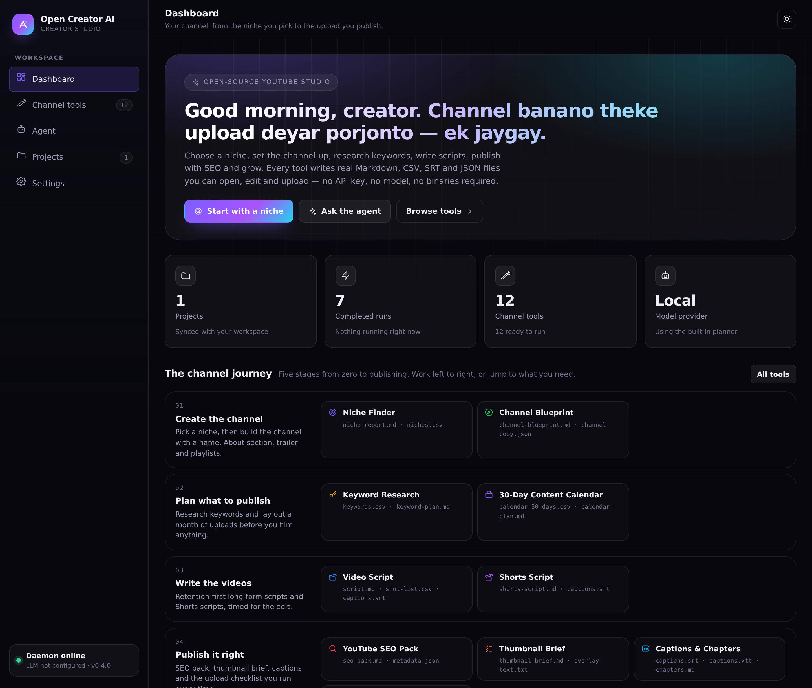
</p>

| Channel tools                                                                                                     | A finished run                                                                                                          |
| ----------------------------------------------------------------------------------------------------------------- | ----------------------------------------------------------------------------------------------------------------------- |
| 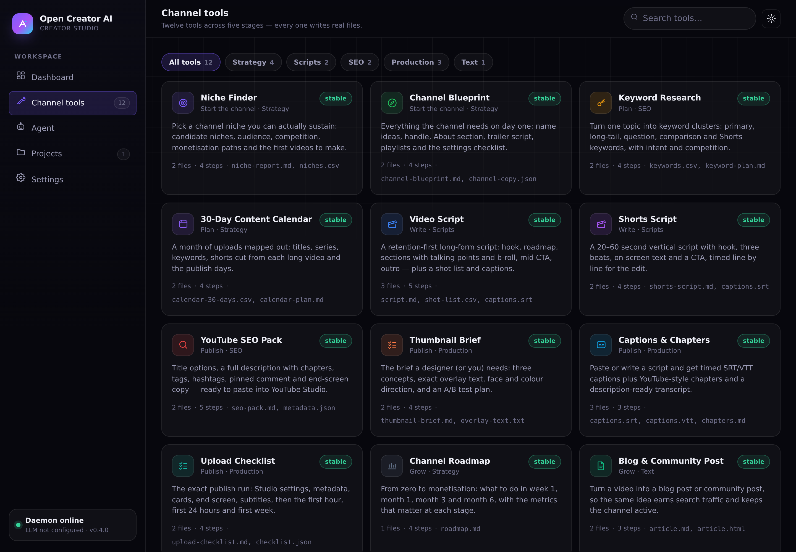 | 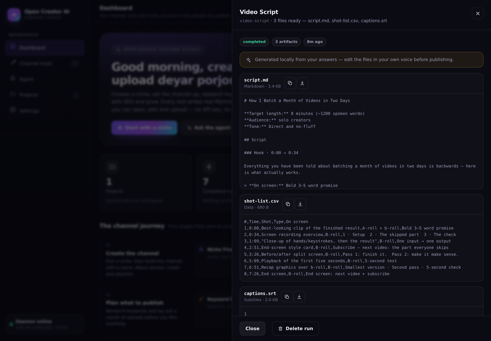 |

| Filling in a tool                                                                                                              | Projects                                                                                                       |
| ------------------------------------------------------------------------------------------------------------------------------ | -------------------------------------------------------------------------------------------------------------- |
| 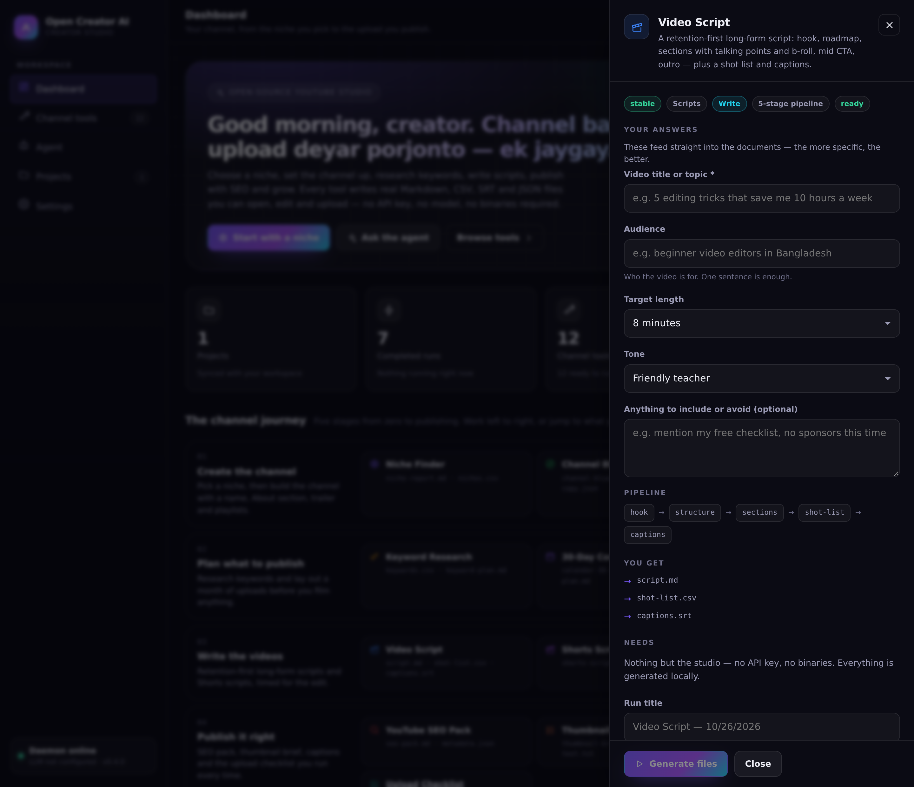 | 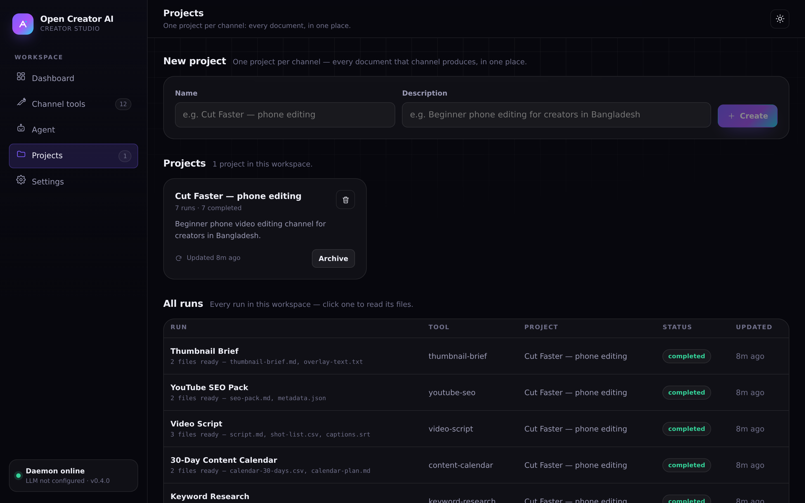 |

<details>
<summary><b>More screenshots — agent, settings, light theme, mobile</b></summary>

| Agent                                                                                                    | Settings                                                                                          |
| -------------------------------------------------------------------------------------------------------- | ------------------------------------------------------------------------------------------------- |
| 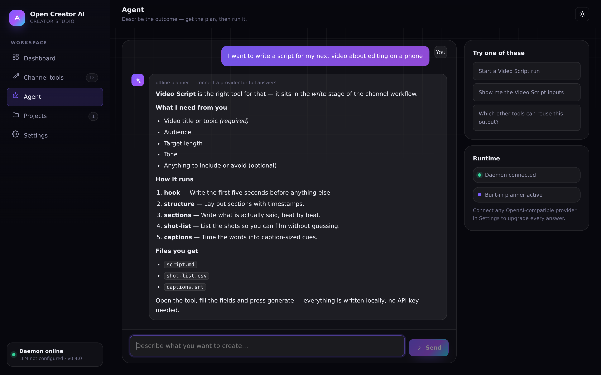 | 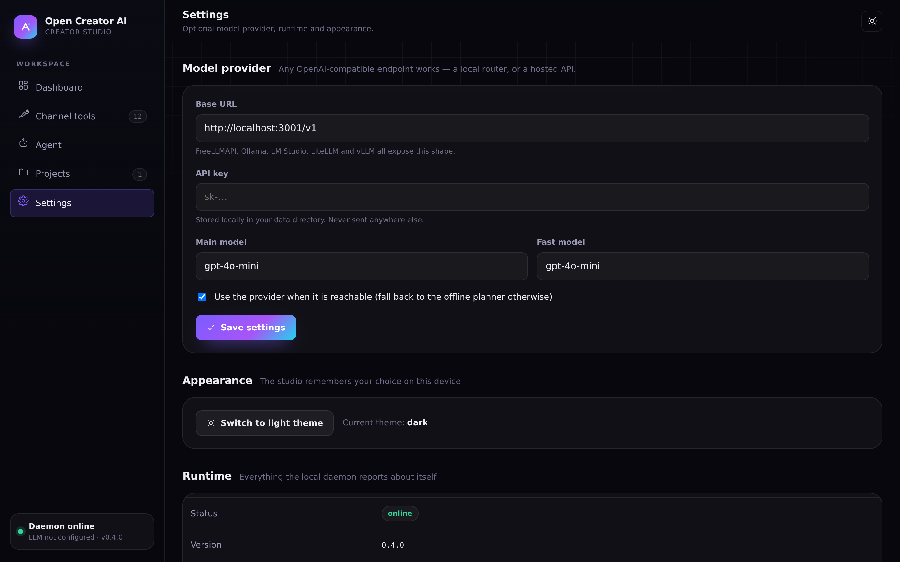 |

| Light theme                                                          | Mobile                                                                            |
| -------------------------------------------------------------------- | --------------------------------------------------------------------------------- |
| 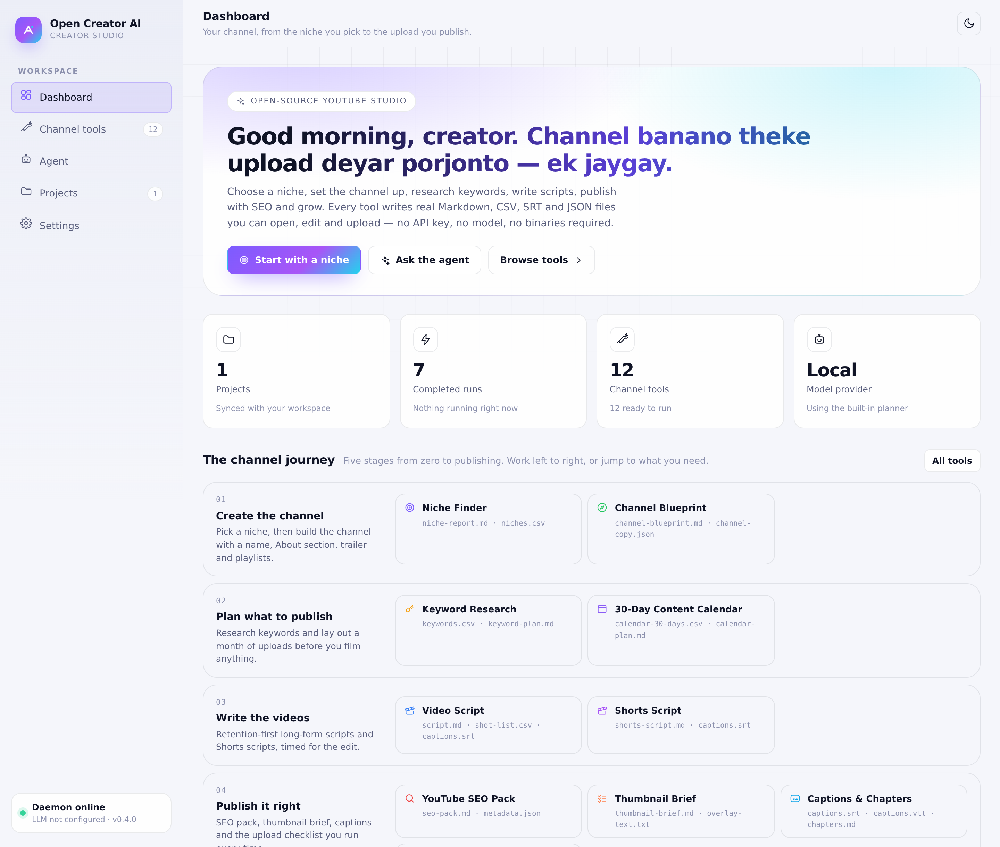 | 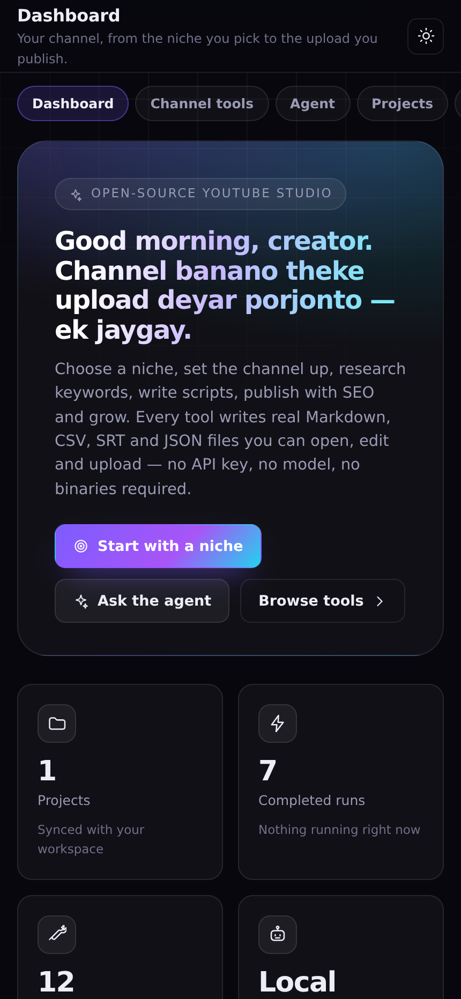 |

All screenshots are captured from the running app, with the demo channel and its seven
completed runs still in the workspace — nothing is mocked up.

</details>

---

## Quick start

```bash
git clone https://github.com/meheditwc/open-creator-ai.git
cd open-creator-ai
npm install
npm run dev
```

That starts two processes:

| Service    | URL                    | What it does                                                |
| ---------- | ---------------------- | ----------------------------------------------------------- |
| **Studio** | http://localhost:19861 | The web workspace (React + Vite)                            |
| **Daemon** | http://127.0.0.1:9861  | Local runtime: projects, runs, settings, the agent endpoint |

Open <http://localhost:19861>, pick a stage on the journey, fill in the form and press
**Generate files**. A second later the run lists its documents — preview them in the drawer,
copy them, or download them. No account, no key, no setup wizard.

<details>
<summary><b>Connect a model provider (optional)</b></summary>

The tools never need a model. The **agent chat** is better with one: point it at any
OpenAI-compatible endpoint — for example a self-hosted [FreeLLMAPI](https://github.com/tashfeenahmed/freellmapi):

```bash
docker run -d -p 3001:3001 ghcr.io/tashfeenahmed/freellmapi:latest
```

Then in **Settings → Model provider**: Base URL `http://localhost:3001/v1`, the unified
API key, and a model such as `gpt-4o-mini`. Without it the agent answers with the same
built-in planner the studio ships.

</details>

---

## The channel journey

Twelve tools, in the order a channel actually happens.

| Stage       | Tool                  | You get                                                                                                                |
| ----------- | --------------------- | ---------------------------------------------------------------------------------------------------------------------- |
| **Start**   | **Niche Finder**      | `niche-report.md`, `niches.csv` — scored candidate niches, audience, competition, monetisation paths, first ten videos |
| **Start**   | **Channel Blueprint** | `channel-blueprint.md`, `channel-copy.json` — names, tagline, About section, banner text, trailer script, playlists    |
| **Plan**    | **Keyword Research**  | `keywords.csv`, `keyword-plan.md` — clustered keywords with intent, suggested titles and a filming order               |
| **Plan**    | **Content Calendar**  | `calendar-30-days.csv`, `calendar-plan.md` — four weeks of slots with real working titles                              |
| **Write**   | **Video Script**      | `script.md`, `shot-list.csv`, `captions.srt` — timed sections, hooks, b-roll notes, spoken word budget                 |
| **Write**   | **Shorts Script**     | `shorts-script.md`, `captions.srt` — 20–60 second beat sheet with on-screen text                                       |
| **Publish** | **YouTube SEO**       | `seo-pack.md`, `metadata.json` — title options with character counts, description with chapters, tags, pinned comment  |
| **Publish** | **Thumbnail Brief**   | `thumbnail-brief.md`, `overlay-text.txt` — concept, composition, overlay words, readability checks                     |
| **Publish** | **Captions**          | `captions.srt`, `captions.vtt`, `chapters.md` — timed cues from your own script                                        |
| **Publish** | **Upload Checklist**  | `upload-checklist.md`, `checklist.json` — the pre-flight you run before every publish                                  |
| **Grow**    | **Channel Roadmap**   | `roadmap.md` — 30/90/180-day milestones, systems, and the income paths at your size                                    |
| **Grow**    | **Article Writer**    | `article.md`, `article.html` — a blog post that repurposes the video for search                                        |

**Every one of these runs offline on your machine.** See
[`docs/TOOLS.md`](docs/TOOLS.md) for the full field-by-field reference, and
[`packages/shared/src/tools.ts`](packages/shared/src/tools.ts) for the source of truth.

---

## How a run works

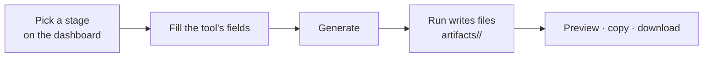

The dashboard groups the tools by stage. Open one, answer its fields and press **Generate
files** — the run walks the tool's pipeline in front of you and lands on a drawer listing
every document with a preview, a copy button and a download button. Every file is plain
Markdown, CSV, JSON, SRT, VTT or HTML, so it opens in whatever editor you already use.

| Screen        | What it is for                                                          |
| ------------- | ----------------------------------------------------------------------- |
| **Dashboard** | The five-stage journey, recent runs and your projects                   |
| **Tools**     | The full catalogue, filterable by stage and category, searchable        |
| **Agent**     | Chat that maps a goal to the right tool — works offline via the planner |
| **Projects**  | One project per channel, grouping every run and file                    |
| **Settings**  | Optional model provider for the agent chat                              |

Project data, runs and generated files live in `OPENCREATOR_DATA_DIR` (default
`.runtime/`), with an atomic JSON store — no database, no cloud, nothing leaves the machine.

---

## Architecture

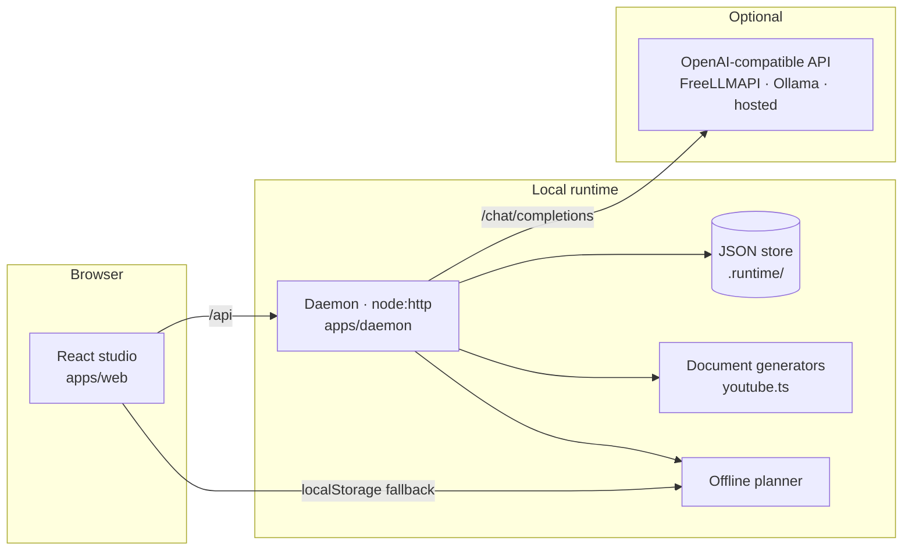

- **One contract, two clients.** `packages/shared` holds the types, the tool
  catalogue and a ready-made `CreatorClient` — the UI, a Codex skill, an MCP
  server or a CI job all speak the same API.
- **Pure generators.** `apps/daemon/src/youtube.ts` builds every document from
  your answers plus a seeded selector, so the same input always produces the
  same output — reviewable, diffable, testable.
- **Degrade, never break.** If the daemon is unreachable the studio keeps
  working from `localStorage` and the agent falls back to the offline planner.
  If the model provider is unreachable, the daemon answers with that same planner.
- **Atomic persistence.** Every write goes to a temp file and is renamed into
  place, so a crash can never leave a half-written project file behind.
- **Failures are explicit.** A run records the exact error, and the test suite
  asserts that every tool writes every file it advertises.

Read the full design notes in [`docs/ARCHITECTURE.md`](docs/ARCHITECTURE.md).

---

## Configuration

Everything is optional — copy `.env.example` to `.env` when you want to change a default.

| Variable                 | Default                    | Purpose                                       |
| ------------------------ | -------------------------- | --------------------------------------------- |
| `PORT`                   | `9861`                     | Daemon port                                   |
| `OPENCREATOR_HOST`       | `127.0.0.1`                | Daemon bind address                           |
| `OPENCREATOR_DATA_DIR`   | `.runtime`                 | Where projects, runs and artifacts are stored |
| `OPENCREATOR_CORS`       | `*`                        | Allowed browser origins (comma separated)     |
| `FREELLMAPI_BASE_URL`    | `http://localhost:3001/v1` | Default provider base URL (agent chat only)   |
| `FREELLMAPI_API_KEY`     | —                          | Default provider key                          |
| `OPENCREATOR_MODEL`      | `gpt-4o-mini`              | Agent model                                   |
| `OPENCREATOR_FAST_MODEL` | `gpt-4o-mini`              | Model for cheap operations                    |

---

## Scripts

| Command              | What it does                                         |
| -------------------- | ---------------------------------------------------- |
| `npm run dev`        | Studio + daemon together                             |
| `npm run dev:web`    | Studio only (http://localhost:19861)                 |
| `npm run dev:daemon` | Daemon only (http://127.0.0.1:9861)                  |
| `npm run build`      | Production build of the studio into `apps/web/dist`  |
| `npm start`          | Serve the built studio from the daemon (single port) |
| `npm run typecheck`  | TypeScript across every workspace                    |
| `npm run lint`       | ESLint                                               |
| `npm test`           | Daemon + web test suites (`node --test`)             |

Typecheck covers `packages/shared` and `apps/web`; the daemon runs TypeScript
directly under Node's type stripping, so `npm test` is its type gate.

---

## Skills

`skills/` holds Codex-style skill files — reusable instructions an agent can
follow for a specific creator workflow.

| Skill               | What it does                                              |
| ------------------- | --------------------------------------------------------- |
| `channel-launch`    | Niche → blueprint → first ten videos, in one pass         |
| `video-production`  | Keyword → script → shot list → captions → SEO → checklist |
| `growth-loop`       | Analytics review, roadmap milestones and blog repurposing |
| `article-repurpose` | Turn a finished video into a search-friendly article      |

See [`docs/SKILLS.md`](docs/SKILLS.md) for how to use and write them.

---

## Contributing

Contributions are very welcome — from a typo fix to a whole new document generator.

```bash
git clone https://github.com/meheditwc/open-creator-ai.git
cd open-creator-ai
npm install
npm run dev
```

Then read [`CONTRIBUTING.md`](CONTRIBUTING.md) and the
[`CODE_OF_CONDUCT`](CODE_OF_CONDUCT.md). If you are adding a tool, start from
[`packages/shared/src/tools.ts`](packages/shared/src/tools.ts) — the catalogue is
the single source of truth for the UI, the API and the docs — then add its
generator to `apps/daemon/src/youtube.ts` and a case to
`apps/daemon/src/worker.ts`. The test suite fails if a tool does not write every
file it advertises.

---

## License

Released under the [Apache License 2.0](LICENSE). Use it, fork it, ship it —
just keep the notice.

<div align="center">

**If this helps you publish faster, a star goes a long way.**

[](https://github.com/meheditwc/open-creator-ai/stargazers)
[](https://github.com/meheditwc/open-creator-ai/network/members)
[](https://github.com/meheditwc/open-creator-ai/issues)

</div>
