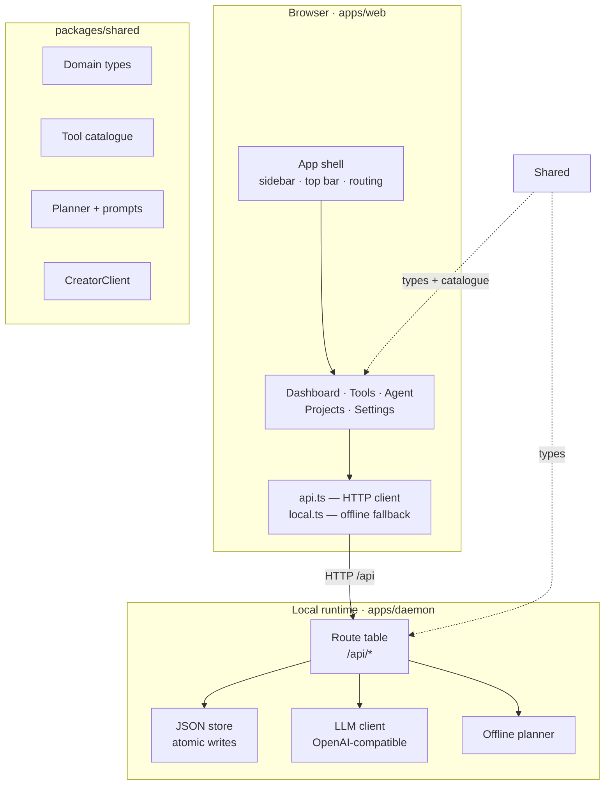
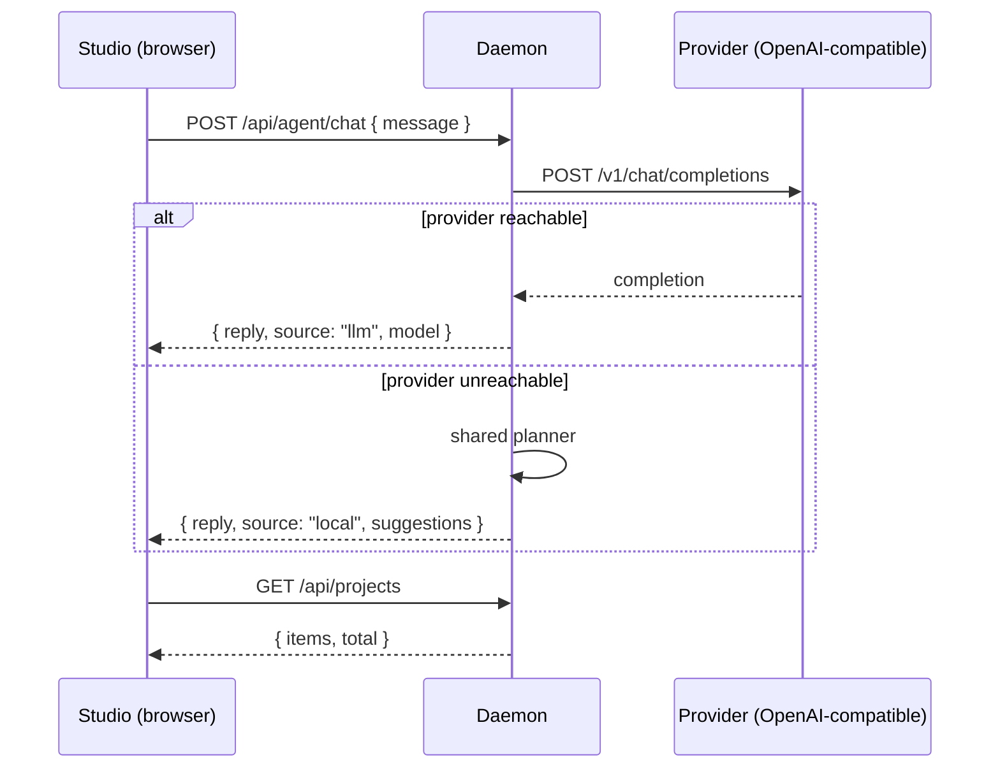
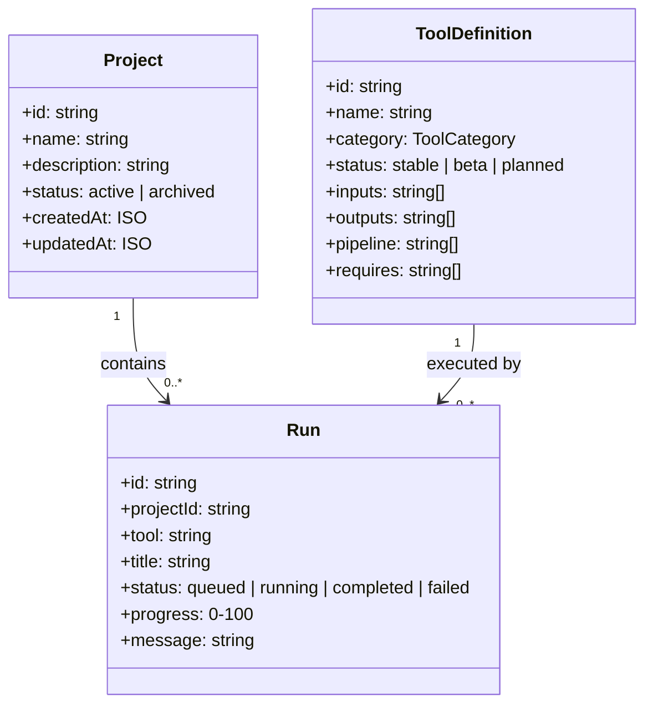

# Architecture

Open Creator AI is deliberately small: **one web client, one local runtime, one shared contract**.
Everything else — models, media binaries, providers — is pluggable and optional.

## The three pieces

### `apps/web` — the studio

React 18 + Vite 5 + TypeScript. No CSS framework: the whole design system lives in
`apps/web/src/styles/global.css` as custom properties plus a small set of component
classes, which keeps the bundle tiny and the rendering identical everywhere.

- **Routing** — a ~40 line hash router (`lib/router.ts`). No dependency, no history surprises.
- **State** — one React context (`state/AppState.tsx`) that owns projects, runs,
  settings and daemon health, and exposes the actions that mutate them.
- **Resilience** — every action has an offline path. If the daemon cannot be reached,
  `lib/local.ts` keeps the workspace in `localStorage` and the UI shows an _Offline mode_
  banner instead of breaking.

### `apps/daemon` — the local runtime

Plain `node:http`, plain `node:fs`, plain `fetch`. It has **zero runtime dependencies**,
so `npm install` never compiles native modules and the daemon boots in milliseconds.

| Concern        | Implementation                                                                    |
| -------------- | --------------------------------------------------------------------------------- |
| Routing        | A route table with `:param` patterns, JSON body parsing, CORS, error envelopes    |
| Persistence    | `store.ts` — one JSON document per collection, written atomically (temp → rename) |
| Agent endpoint | `POST /api/agent/chat` — talks to the provider, falls back to the shared planner  |
| Health         | `GET /api/health` — uptime, counts, and a live probe of the model provider        |
| Static hosting | Serves `apps/web/dist` when it exists, so `npm start` is a single-port deployment |

### `packages/shared` — the contract

The only place that both sides are allowed to disagree about. It contains:

- `types.ts` — the domain model (`Project`, `Run`, `ToolDefinition`, `AppSettings`, …)
- `tools.ts` — the tool catalogue: the single source of truth for the UI, the API validation
  and the documentation
- `planner.ts` — the offline planner and the agent system prompt, shared by the daemon
  and the browser so both answer identically
- `client.ts` — `CreatorClient`, a typed client for the HTTP API that works in Node and
  in the browser, so skills and CI jobs can reuse it

## Request flow

## Design decisions

**Why JSON files instead of SQLite?**
Native database drivers mean a compiler on every install. JSON documents with atomic
writes give us durability for the data we actually store (projects, runs, settings) with
zero install friction. The storage layer is behind `JsonStore`, so swapping in SQLite
later is a contained change.

**Why does the daemon simulate run progress?**
The pipelines that do the real work need `ffmpeg`, `yt-dlp`, `whisper` and model
providers — none of which can be assumed present. The daemon therefore models a run as
a state machine (`queued → running → completed`) with honest messages about what a
local worker would need to do. When a worker is wired in, it takes over the same
transitions instead of replacing them.

**Why does the agent have a local planner?**
Because a studio that answers _"configure an API key first"_ to a first-time user is a
bad studio. The planner detects intent, picks the matching tool and returns a real
pipeline plan — inputs, stages, outputs, requirements — with zero configuration.

**Why hand-written CSS?**
A utility framework is a build dependency, a class-name convention and a migration
story. A token-driven stylesheet is ~700 lines, ships nothing extra, and lets the
dark and light themes share one variable block.

## Data model

## Extending it

| I want to…                       | Do this                                                                                    |
| -------------------------------- | ------------------------------------------------------------------------------------------ |
| Add a creator tool               | Add an entry to `packages/shared/src/tools.ts` — the UI, API and docs follow automatically |
| Add a real worker for a pipeline | Implement the stage transitions in `apps/daemon/src/server.ts` (`advanceRun`)              |
| Use the API from a script        | `import { CreatorClient } from '@open-creator/shared'`                                     |
| Change the look                  | Edit the tokens at the top of `apps/web/src/styles/global.css`                             |
